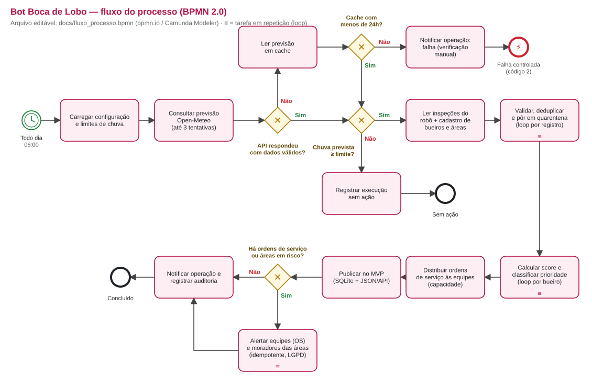

# 🌧️ CitizenTech · Boca de Lobo — Bot RPA de prevenção de alagamentos

> **FIAP · Global Solution 2026.2 · Engenharia de Software 4º ano**
> Disciplina: **Robotic Process Automation** — *Do Processo Manual à Automação Inteligente*
> Componente do MVP: **Automação**

Todo verão, moradores das áreas baixas e periféricas veem a rua virar rio porque as **bocas de lobo estavam
entupidas de lixo e folhas** quando a chuva chegou. Hoje, decidir *quais* bueiros limpar antes de um temporal é um
processo manual: alguém consulta a previsão, abre planilhas de inspeção, cruza com o mapa de áreas de risco, monta a
lista para as equipes e avisa a população por telefone/WhatsApp. É lento, sujeito a erro e acontece tarde demais.

**O bot Boca de Lobo automatiza esse processo de ponta a ponta.** Toda manhã ele:

1. **Lê a previsão de chuva** das próximas 24h (API pública Open-Meteo), com retentativa e cache de contingência;
2. **Decide** se a chuva prevista passa do limite (NORMAL / ATENÇÃO / ALERTA);
3. Se passar, **lê as inspeções** feitas pelo robô de visão computacional nas bocas de lobo, **valida, deduplica e
   põe em quarentena** dados ruins;
4. **Calcula um score de prioridade** para cada bueiro (obstrução + risco da área + histórico de alagamentos);
5. **Gera ordens de serviço** distribuídas entre as equipes de limpeza respeitando a capacidade de cada uma;
6. **Publica o resultado no MVP** (banco SQLite + JSON/CSV + API REST + dashboard com mapa);
7. **Dispara alertas** às equipes e aos moradores inscritos das áreas em risco (*onde não passar*), sem duplicar e
   respeitando o consentimento LGPD;
8. **Registra logs de auditoria** (JSON Lines) e notifica a operação — inclusive quando algo falha.


---

## 👥 Integrantes

| Nome | RM |
|---|---|
| Açussena Macedo Mautone | RM552568 |
| Felipe Heilmann Marques | RM551026 |
| Felipe Voidela Toledo | RM98595 |
| Carlos Eduardo Caramante Ribeiro | RM552159 |
| Ian Cancian Nachtergaele | RM98387 |

🎥 **Vídeo demonstrativo:** *link do vídeo* · 📄 **Relatório técnico:** [`docs/Relatorio_Tecnico_RPA.pdf`](docs/Relatorio_Tecnico_RPA.pdf)

---

## 🧭 Fluxo do processo (BPMN)



Arquivo BPMN 2.0 editável: [`docs/fluxo_processo.bpmn`](docs/fluxo_processo.bpmn) (abra em <https://demo.bpmn.io>
ou no Camunda Modeler). Gerado por [`docs/gerar_bpmn.py`](docs/gerar_bpmn.py).

## 🏗️ Arquitetura

```
 Agendador (06:00)        ┌──────────────────── Bot RPA (Python) ────────────────────┐
 Windows / cron / GitHub  │ previsao.py → regras.py → dados.py → regras.py → alertas │
 Actions ───────────────▶ │  (API+cache)  (decisão)   (validação)  (score/OS)        │
                          └───────┬───────────────────────────────┬─────────────────┘
  Fontes:                         │ persistencia.py               │ log_utils.py
  • Open-Meteo (API)              ▼                               ▼
  • data/inspecoes/*.csv   output/citizentech.db  ◀── src/api.py ── mvp/index.html
    (robô de inspeção)     output/api/*.json          (API REST)    (dashboard/mapa)
  • data/bueiros.json      output/outbox/*.jsonl  → gateway SMS/WhatsApp/e-mail
  • data/areas_risco.json  logs/bot_AAAAMMDD.jsonl (auditoria)
  • data/moradores_inscritos.csv
```

| Módulo | Responsabilidade |
|---|---|
| `src/main.py` | Ponto de entrada (CLI) chamado pelo agendador; devolve código de saída |
| `src/bocadelobo/bot.py` | Orquestra todas as etapas e trata exceções |
| `src/bocadelobo/previsao.py` | Consulta a Open-Meteo, 3 tentativas com backoff, valida resposta, cache |
| `src/bocadelobo/dados.py` | Lê cadastros e inspeções, valida linha a linha, deduplica |
| `src/bocadelobo/regras.py` | Regras de negócio: nível de chuva, score, prioridade, equipes, áreas de alerta |
| `src/bocadelobo/alertas.py` | Mensagens, idempotência, LGPD, webhook da operação |
| `src/bocadelobo/persistencia.py` | SQLite + exportação JSON/CSV para o MVP |
| `src/bocadelobo/log_utils.py` | Logs JSON de auditoria com mascaramento de dados pessoais |
| `src/bocadelobo/api_core.py` | Rotas, filtros, validação e autenticação da API (independe de onde roda) |
| `src/api.py` | Servidor da API REST local + dashboard |
| `src/aws_lambda.py` | A mesma API e o bot como funções AWS Lambda (S3 como armazenamento) — preparado, não publicado |

**Tecnologias:** Python 3.9+ **somente biblioteca padrão** (sem `pip install`), SQLite, API Open-Meteo, Leaflet +
OpenStreetMap no dashboard, GitHub Actions para agendamento. *Por quê Python e não UiPath/Power Automate?* O processo
é 100% de dados (API, arquivos, banco, mensagens) — não há interface gráfica legada para "clicar"; em Python o bot
fica versionado, testável automaticamente, roda de graça em qualquer servidor/agendador e se integra direto ao MVP.

## ⚙️ Regras de negócio

**Decisão 1 — a chuva justifica agir?** (`config/config.json → limites_chuva`)

| Condição | Nível | Ação |
|---|---|---|
| chuva 24h ≥ 50 mm | **ALERTA** | OS para prioridades CRÍTICA, ALTA e MÉDIA; alerta a todas as áreas de risco ≥ 2 |
| chuva 24h ≥ 20 mm **ou** pico ≥ 10 mm/h com probabilidade ≥ 60% | **ATENÇÃO** | OS para CRÍTICA e ALTA; alerta às áreas com bueiro CRÍTICO |
| abaixo disso | NORMAL | registra execução e encerra (sem ação) |

**Score de prioridade (0–100)** = 0,5 × obstrução(%) + 0,3 × risco da área (1–3 → 0–100) + 0,2 × histórico de
alagamentos (0–10 → 0–100) → **CRÍTICA ≥ 70 · ALTA ≥ 50 · MÉDIA ≥ 30 · BAIXA**.

**Outras decisões:** obstrução < 30% não gera OS · inspeção com mais de 7 dias ou confiança da visão < 0,6 → OS
marcada para **reinspeção** · bueiro sem inspeção → pedido de nova ronda do robô · equipes com capacidade
(3 × 5 bueiros); acima disso → **AGUARDANDO_REFORCO** e aviso à operação · equipe preferida = a que já atende a mesma
área (menos deslocamento).

**Repetição:** loop pelos arquivos de inspeção → loop pelas linhas → loop por bueiro do cadastro (score) → loop por
OS (equipes) → loop por área e por morador (alertas).

## 🛡️ Exceções e resiliência

| Falha prevista | Tratamento |
|---|---|
| API de previsão fora do ar / timeout / HTTP ≠ 200 | 3 tentativas com backoff exponencial (1s, 2s) |
| API responde lixo (HTML, JSON incompleto, < 12h de dados, valor negativo) | tratado como falha → retentativa |
| API indisponível após tentativas | usa **cache** da última previsão se tiver < 24h |
| Sem API e sem cache válido | **falha controlada**: status `FALHA_PREVISAO`, código de saída 2, notifica a operação |
| Arquivo de inspeção com colunas erradas / ilegível | arquivo ignorado, registrado em `output/quarentena/` |
| Linha inválida (obstrução vazia, > 100, não numérica, data inválida/futura, bueiro não cadastrado) | linha rejeitada com motivo, demais seguem |
| Linha duplicada / bueiro repetido no lote | descartada; mantém a inspeção mais recente |
| Nenhuma inspeção válida / cadastro ausente | `FALHA_DADOS`, código 3, notifica a operação |
| Reexecução no mesmo dia | **idempotência**: alerta com mesma chave não é reenviado |
| Webhook da operação fora do ar | 3 tentativas; falha contabilizada no resumo, sem derrubar o bot |
| Erro inesperado | capturado, logado, `FALHA` código 1 — **nunca falha silenciosa** |

## 📜 Logs e auditoria

* `logs/bot_AAAAMMDD.jsonl` — um evento por linha: data/hora, nível, `execucao_id`, etapa, mensagem e dados.
* Tabela `execucoes` no banco — resumo de cada execução (lidos, válidos, rejeitados, duplicados, OS, alertas, falhas).
* `output/quarentena/rejeitados_<execucao>.csv` — cada registro rejeitado e o motivo.
* Dados pessoais **nunca** vão para log: telefone e e-mail são mascarados (`(11) 9****-**72`, `a***@exemplo.com`) e
  um filtro remove qualquer telefone/e-mail que escape. Alertas referenciam o morador pelo **ID**.

## 🔌 Integração com o MVP CitizenTech

O resultado é consumido pelos outros componentes por **três vias**:

| Via | Onde | Quem consome |
|---|---|---|
| **API REST** | `python src/api.py` → `http://localhost:8000/api/...` (contrato em [`docs/openapi.yaml`](docs/openapi.yaml)) | dashboard, app do cidadão, app das equipes, carrinho |
| Banco de dados | `output/citizentech.db` (tabelas `execucoes`, `ordens_servico`, `alertas`) | back-end do MVP |
| Arquivos estruturados | `output/api/ultimo_resultado.json`, `output/api/execucoes.json`, `output/ordens_servico_<execucao>.csv` | BI, integrações em lote |

O **dashboard** (`mvp/index.html`, servido em `/`) consome a API e mostra nível de risco, KPIs, mapa com as bocas de
lobo por prioridade, lista para limpeza, alertas emitidos, **log de auditoria da execução** e histórico de execuções.

**Tudo pelo painel, sem terminal:** dê dois cliques em [`abrir_painel.bat`](abrir_painel.bat) (Windows). Ele sobe o
servidor local numa janela minimizada e abre o navegador. A **Central do robô**, no topo do painel, executa o bot e
simula os cenários:

| Botão | O que acontece |
|---|---|
| ▶ Rodar com a previsão real | Consulta a Open-Meteo, decide e executa o processo completo |
| 🌧 Simular chuva (mm) | Força a chuva prevista: 75 mm = ALERTA, 30 mm = ATENÇÃO, 5 mm = sem ação |
| ⚠ Simular API de previsão fora do ar | 3 tentativas com espera crescente, depois cache (< 24 h) ou falha controlada (código 2) |
| 🧹 Nova demonstração | Apaga resultados e logs locais (mantém o cache) para os alertas saírem de novo |

Cada execução também é publicada no S3 (`rpa/entrada/`), e o site integrado do MVP mostra o resultado na aba
**Limpeza (RPA)**: https://felipevoidela.github.io/GS2-2026-Big-Data-Architecture/. Uma versão só de leitura do painel
fica publicada no GitHub Pages: https://acussena.github.io/rpa_gs/

### 🌐 API REST

| Método | Rota | O que faz |
|---|---|---|
| GET | `/api/status` | Última execução do bot (nível, chuva prevista, contadores) |
| GET | `/api/ordens` | Lista priorizada de bocas de lobo. Filtros: `?prioridade=CRITICA,ALTA&equipe=EQ-01&area=AR-01&status=ABERTA` |
| GET | `/api/ordens/{id_bueiro}` | Ordem de serviço de um bueiro (ex.: `/api/ordens/BL-001`) |
| GET | `/api/alertas` | Alertas do dia, com contatos mascarados (`?area=&publico=morador`) |
| GET | `/api/alertas/publico` | Um alerta por área, **sem dados pessoais** — para o app do cidadão (`?area=AR-01`) |
| GET | `/api/pendencias` | Bueiros sem inspeção, ordens aguardando reforço e a reinspecionar |
| GET | `/api/execucoes` | Histórico de execuções (auditoria) |
| POST | `/api/inspecoes` | **O carrinho envia a ronda de inspeção** (JSON) → vira CSV em `data/inspecoes/` |
| POST | `/api/executar` | Roda o bot agora: `{"simular_chuva": 75}` |

As rotas **POST** exigem o cabeçalho `x-api-key` quando a variável `API_TOKEN` está definida. Erros seguem HTTP:
`400` JSON inválido, `401` sem token, `404` rota/recurso inexistente, `422` inspeção sem campos obrigatórios (nada é
gravado), `502` o bot terminou em falha controlada.

```bash
curl "http://localhost:8000/api/ordens?prioridade=CRITICA&equipe=EQ-01"
curl -X POST http://localhost:8000/api/inspecoes -H "Content-Type: application/json" \
  -d '{"robo_id":"carrinho01","inspecoes":[{"id_bueiro":"BL-024","data_hora_inspecao":"2026-11-18T05:40:00","nivel_obstrucao":90}]}'
curl -X POST http://localhost:8000/api/executar -d '{"simular_chuva": 75}'
```

A lógica da API fica em `src/bocadelobo/api_core.py` e não depende de onde roda. A pasta [`aws/`](aws/) já traz a
versão para **AWS (API Gateway + Lambda + S3)**, com o mesmo código, pronta para quando a integração for feita.

### ☁️ Publicação automática no Amazon S3

Ao fim de **cada execução**, o bot junta o resultado e o histórico num único arquivo e o envia ao bucket de ingestão
do MVP:

```
s3://boca-lobo-s3-ingestao/rpa/entrada/bocaLobo_AAAAMMDD_HHMMSS.json      (data e hora do início da execução)
```

| Campo do arquivo | Conteúdo |
|---|---|
| `execucao` | Resumo da execução: nível, chuva prevista, contadores, status |
| `ordens_servico` | Lista priorizada de bocas de lobo para limpeza |
| `alertas` | Alertas do dia (contatos mascarados) |
| `bueiros_sem_inspecao` | Bueiros que precisam de nova ronda do carrinho |
| `historico_execucoes` | Todas as execuções registradas (auditoria) |

* Configuração em `config/config.json → publicacao_s3` (bucket, pasta `rpa/entrada/`, região). Desligar sem editar: `PUBLICAR_S3=0`.
* Credenciais **nunca** no código: o bot usa as do ambiente (`aws configure` ou variáveis `AWS_ACCESS_KEY_ID` /
  `AWS_SECRET_ACCESS_KEY`). Basta a permissão `s3:PutObject` em `boca-lobo-s3-ingestao/rpa/entrada/*`.
* 3 tentativas com espera crescente e conferência de integridade (ETag do S3 = MD5 do arquivo).
* Se o envio falhar, o bot **não para**: registra no log, marca `publicacao_s3 = FALHA` no resumo e avisa a operação.
* Cópia local de cada arquivo enviado em `output/publicado/`.

## ▶️ Como executar

Requisito: **Python 3.9+** (nenhuma dependência externa).

```bash
python src/main.py                      # previsão real (Open-Meteo)
python src/main.py --simular-chuva 75   # cenário de chuva forte (ALERTA)
python src/main.py --simular-chuva 30   # cenário ATENÇÃO
python src/main.py --simular-chuva 5    # cenário sem ação
python src/main.py --falhar-api         # simula API fora do ar (cache ou falha controlada)
python src/api.py                       # API REST + dashboard em http://localhost:8000 (ou abrir_painel.bat)
python -m unittest discover -s tests -v # testes automatizados
```

No Windows, use `py` no lugar de `python` se necessário. Webhook opcional para a operação (Discord/Slack/Teams):
defina a variável `ALERTA_WEBHOOK_URL`.

**Agendamento diário:** GitHub Actions ([`.github/workflows/bot-diario.yml`](.github/workflows/bot-diario.yml), 06:00)
ou Agendador do Windows ([`scripts/agendar_windows.ps1`](scripts/agendar_windows.ps1)) ou cron
(`0 6 * * * cd /caminho && python src/main.py`).

No GitHub Actions, a execução das 06:00 (horário de Brasília) roda os testes e o bot, publica o arquivo no S3
(`rpa/entrada/`) e grava `output/` e `logs/` de volta no repositório. Assim o painel do GitHub Pages
(https://acussena.github.io/rpa_gs/) sempre mostra a última execução. Para publicar no S3, cadastre em
*Settings → Secrets and variables → Actions* os secrets `AWS_ACCESS_KEY_ID` e `AWS_SECRET_ACCESS_KEY`. Sem eles, o bot
roda normalmente e só a publicação no S3 fica desligada. Teste manual: aba *Actions → Bot Boca de Lobo → Run workflow*.

## ✅ Testes

48 testes automatizados (`tests/test_bot.py` — bot; `tests/test_api.py` — API e versão AWS; `tests/test_publicacao.py` — envio ao S3) cobrindo **sucesso, decisão e falha**; evidências em
[`tests/evidencias/`](tests/evidencias/):

| Evidência | Cenário | Resultado |
|---|---|---|
| `00_testes_automatizados.txt` | suíte completa | 48/48 OK |
| `01_previsao_real.txt` | API real | previsão obtida, decisão tomada |
| `02_api_fora_usa_cache.txt` | falha — API fora | 3 tentativas → usa cache |
| `03_falha_api_sem_cache.txt` | falha — API fora sem cache | `FALHA_PREVISAO`, código 2, operação notificada |
| `04_decisao_sem_acao.txt` | decisão — 5 mm | `SEM_ACAO` |
| `05_decisao_atencao.txt` | decisão — 30 mm | ATENÇÃO: só CRÍTICA/ALTA |
| `06_sucesso_alerta.txt` | sucesso — 75 mm | ALERTA: 19 OS, 17 alertas, 7 rejeições em quarentena |
| `07_idempotencia_reexecucao.txt` | reexecução | 0 alertas reenviados |

## 🔒 Segurança e LGPD

* **Minimização:** o bot só lê do morador o necessário para o alerta (área, canal, contato); logs e saídas usam o ID.
* **Consentimento:** só recebe alerta quem tem `consentimento_lgpd = sim` (base legal: consentimento, art. 7º, I;
  e proteção da vida/incolumidade física, art. 7º, VII).
* **Mascaramento** de telefone/e-mail em tudo que é exibido; filtro de segurança nos logs.
* **Segredos** (URL do webhook) só por variável de ambiente / GitHub Secrets — nunca no código.
* **Dados de exemplo fictícios** (nomes, telefones e endereços inventados).
* API do MVP somente leitura; a rota pública `/api/alertas/publico` não contém dados pessoais.

## 📁 Estrutura

```
├── README.md
├── config/config.json          # limites, pesos, equipes (sem mexer em código)
├── data/                       # fontes: cadastro, áreas de risco, moradores, inspeções do robô
├── src/                        # código-fonte Python (bot + API)
├── mvp/index.html              # dashboard do MVP
├── docs/                       # BPMN, relatório técnico PDF e geradores
├── assets/                     # prints e evidências visuais
├── logs/                       # amostra de logs gerados (sem dados sensíveis)
├── output/                     # saídas da última demonstração (banco, JSON, CSV, outbox, quarentena)
├── tests/                      # testes automatizados + evidências
├── aws/                        # versão AWS pronta (SAM: Lambda + API Gateway + S3) — ainda não publicada
├── scripts/agendar_windows.ps1
└── .github/workflows/bot-diario.yml
```
